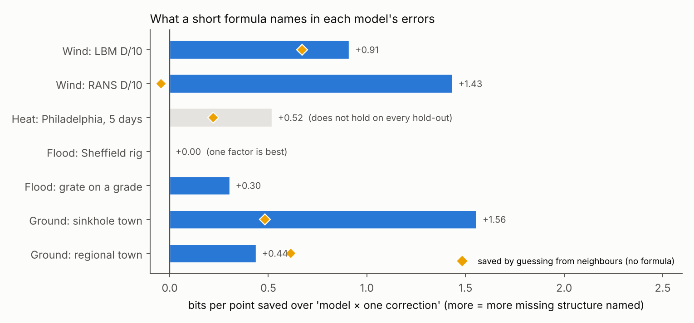
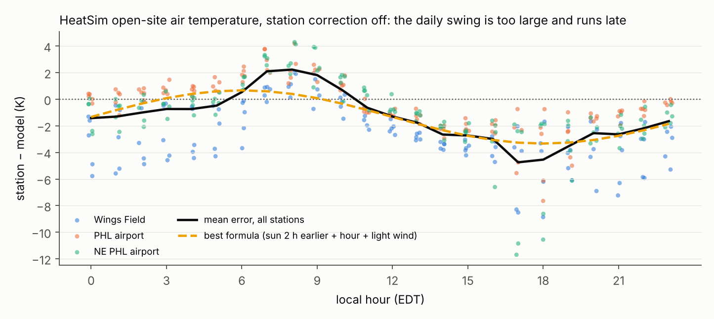
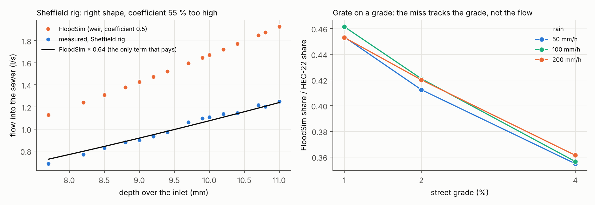
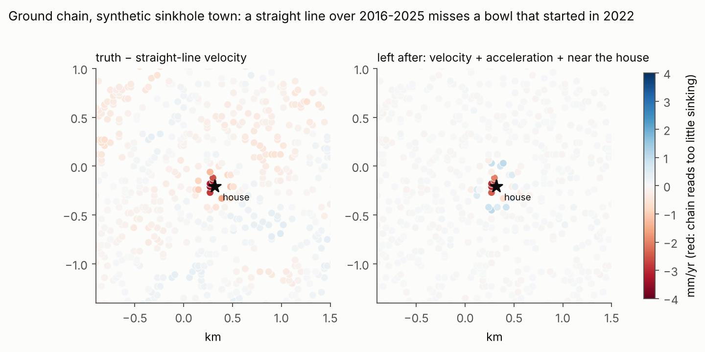

# What flood, heat and ground are missing, by code length (22 Nov 2026)

This applies the same test as [FINDINGS.md](FINDINGS.md) (wind) to the other three models. The protocol,
[PROTOCOL-2.md](PROTOCOL-2.md), was pushed before any of these errors was fitted (commit 88b2544). Scripts:
`physics/heat.py`, `flood.py`, `ground.py`, `figures2.py`. Results: `results/physics/{heat,flood,ground}.json`.

Each bar is how many bits per point a short formula saves over "model × one correction factor". Blue means the
formula also held up on data it wasn't fitted to. The diamonds show the model-free check: each point guessed from
its neighbours, with no formula at all.

## Heat: HeatSim's daily swing is too large and runs late
**Data.** HeatSim 0.6.1, CDS forcing, station correction off (`phl_noanchor_*`, the five hottest July 2025 days:
8, 25, 28, 29 and 30 July, in three files). The quantity is open-site air temperature at the cell of each of three land
ISD stations (Wings Field, PHL, NE PHL), compared with the stations' hourly readings: 360 station-hours. These
stations feed ERA5, so the comparison is not independent.

- **Structure: yes.** An hour's error is well predicted by the other stations' errors at the same hour (6.55 bits
  against 7.07 ± 0.04 shuffled, p = 0.005). The miss is weather-wide, not a quirk of one station.
- **Overall:** the model reads 1.3 K warmer than the stations.
- **Best formula:** a 24-hour shape, plus station offsets or sunlight about 2 h earlier, plus a light-wind term.
  This saves 0.52 bits per point. The error is about +2 K in the morning (model too cool) and about −3 to −4.5 K
  in the late afternoon (model too warm).
- **Direct check (post hoc):** the model's daily range is 12.4 to 14.4 K, against 10.2 to 13.7 K measured, about
  25 % too large. The best time shift is 0 to 1 h late.
- **It does not transfer to every hold-out.** The winner uses station offsets, which can't carry over to a station
  left out. The best formula without them (sunlight 2 h earlier + 24 h shape + light wind) holds on every held-out
  day and on PHL and NE PHL. It fails on Wings Field, the one station with trees and roofs in its cell. So this is
  a lead, not a law: five days can't separate a physics term from those days' weather. Several −8 to −12 K hours at
  17:00-18:00 look like storm outflows that a run without station correction can't know about.
- **Lead for HeatSim's own protocol:** the open-site layer heats too much by day and holds heat too late. Two
  candidates: too little heat capacity or storage in the ground and grass, or a daytime mixed layer that is too
  shallow. Before either, rule out a timing convention. ERA5 accumulated fields are stamped at the end of their
  hour, and a one-hour slip would produce exactly a late, oversized cycle.
- **Timing check (post hoc, HeatSim `a5fd110`):** the core run treats ERA5 sunlight as if it were the value at
  each hour stamp. Between stamps it interpolates linearly (`simulate.py`, the substep loop over `V[i]`, `V[i+1]`).
  But the stamp holds the mean over the hour *ending* there, and HeatSim's own `street.py` says so and corrects
  for it with the mid-hour sun (line 506). The core run therefore gets its sunlight about 30 minutes late. That
  accounts for some of the late timing but not for the 25 % excess in range. Test it in HeatSim's own protocol by
  shifting S, Sdir and Sdif back by half an hour and rerunning these five days with the station correction off.

## Flood: the inlet law has the right shape and the wrong size; a grate on a grade misses with the grade

**F1, Sheffield rig (15 measured tests, PV-SS10).** One correction factor beats every formula: FloodSim × 0.64
(7.07 bits against 7.37 for the next best). The weir law's shape, flow ∝ depth^1.5, fits the measurements. Only
the coefficient is wrong: 0.5 should be 0.32, which agrees with F15's own fit. The depth datum term does not pay
either. Whether the approach flow (velocity) matters can't be decided from this rig: depth and inflow move
together across the 15 tests (r = 0.9994). One-term formulas did code the held-out half slightly better, but the
MDL winner on all 15 tests is the factor, so that is what is reported.

**F2, a grate on a grade (9 cases against HEC-22, PV-SS13).** The search picks **street grade** (r = −0.996 with
the error), not gutter velocity (r = −0.79). That formula holds when each rain rate is left out. The protocol
asked whether velocity would rank first. **It did not, so the naming test fails as written.** What the data say
is sharper: at a fixed grade, FloodSim's miss barely changes with rain, so flow and velocity are not the driver.
The miss grows with grade because the same flow runs shallower on a steeper street, and FloodSim's grate takes
water by depth. HEC-22's grate takes the frontal flow whatever the depth. The fix named by this is a flux-based
capture (a share of the gutter flow reaching the grate), which is the change F21 already proposes. This case
agrees with it and points at the depth dependence as the part to remove.

## Ground: the straight-line velocity misses motion that starts mid-record
CHI's four synthetic towns, where the planted truth is known (3,000 cells each).

| Town | One correction | Best formula | What it says |
|---|---|---|---|
| quiet | −1.48 mm/yr | velocity × −1 (all cell-to-cell detail is noise) | the reference offset (planted +1.5) is found; nothing moves |
| bad reference | **+13.1 mm/yr** | the same | the offset is almost twice the planted −7: the two date jumps fold into the straight line |
| regional | 0.0 | velocity × −0.41, distance | the chain's cell-to-cell detail is about 60 % noise; shrink it toward the area mean |
| sinkhole | 0.0 | velocity, **acceleration**, near the house | the onset term the protocol expected is found |

- In every town the neighbour test finds structure (p = 0.01, 99 shuffles), and every winning formula holds
  west → east and east → west.
- **The sinkhole term is found, but it is weak.** At the house (within 100 m) the truth is −5.1 mm/yr, the chain
  reads −2.1, and the formula only gets to −2.5. A per-cell acceleration is too noisy to rebuild an onset. The
  right fix is in the chain: fit a change point (onset) instead of one straight line over 2016-2025. CHI's
  `m4_change` already tests for change; the rate it reports should come from after the change.
- **The bad-reference town is the useful surprise:** a reference pixel with jumps corrupts the velocity by twice
  its planted offset. A step check on the reference series belongs before any rate is read.
- These towns are synthetic, so the "physics" is what we planted. This shows the test catching what the chain's
  processing distorts. It does not discover new ground physics.

## Across the four models
- **Wind:** a shape (contrast and entrance) that fades with LBM resolution, then one uniform factor. RANS keeps
  the shape, so the gap is in the steady model itself.
- **Heat:** a daily-cycle shape that is real (p = 0.005) but not yet stable across days. It needs more days.
- **Flood:** the exchange law has the right shape and a coefficient about 1.55× too high. On a grade the depth
  dependence is the gap.
- **Ground:** the straight line misses an onset, and a jumping reference doubles the offset.

Nothing here validates or changes a model. Each lead goes to its own repository's protocol, and none is applied
to a report.
