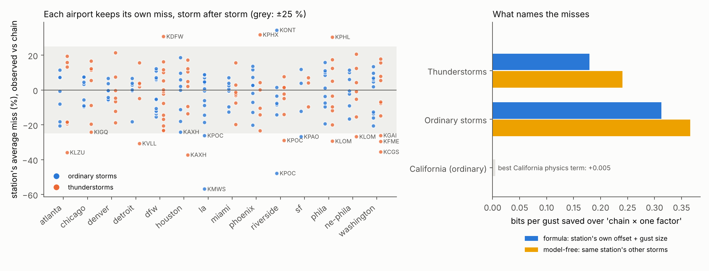

# What WindSim's storm-gust chain (Layer 1) is missing, by code length (22 Nov 2026)

Protocol: [PROTOCOL-3.md](PROTOCOL-3.md), pushed before any fit (de49495), with amendment A1 (60fd99d). Script
`physics/layer1.py`, post hoc checks `physics/layer1_posthoc.py`, chart `physics/figures3.py`. Data: WindSim PR 10
(d36598b) check files, 2,396 station-storm pairs at 14 places after the hurricane split (F2, 63dd5c5), and the run 4
and A3 files from before it. Results: `results/physics/layer1*.json`, logs `layer1.log`, `layer1_firstrun.log`.

## The short answer
**The misses belong to the airports, not to the weather.** Every station keeps its own miss from storm to storm.
Phoenix Sky Harbor reads about 30 % above the chain in thunderstorms, Mount Wilson 57 % below it in ordinary storms,
Brackett Field 26-48 % below. Knowing a station's miss in its *other* storms is the only term that pays, and it holds
at every left-out place and from calibration to blind (model-free check p = 0.01). No physics term in the vocabulary
pays on its own: not wind direction, offshore (Santa Ana) direction, season, hour, terrain height between stations,
roughness or storm size.

## Q1, thunderstorms (903 pairs)
- Best formula: the station's own offset (× 0.71) plus gust size (larger predicted gusts read lower, × −0.31, which is
  the usual regression of an interpolated value). Saves 0.18 bits per gust; sd of the log miss 0.25 → 0.22.
- **The ±30 % band is the right form.** Most of the scatter is left after the offset, so a range is still needed.
  A wider range per place does not pay, and a Phoenix-only width does not either (−0.013 bits per gust).
- **Phoenix (64 % inside the range):** the misses are one-sided. 23 % of Phoenix gusts are above the range and 13 %
  below. Sky Harbor (KPHX) reads +32 % on average, while Williams Gateway, Goodyear and Glendale read 20-25 % low.
- **Atlanta (69 %):** a split by station. Hartsfield (KATL), Peachtree (KPDK) and Dobbins read high, and Gwinnett
  (KLZU, −36 %), Fulton, Falcon Field and Cobb read low.
- The same pattern is at DFW (KDFW +31 %) and Philadelphia (KPHL +30 %). The large commercial airports read high.

## Q2, ordinary storms, and California (1,085 pairs)
- Best formula: the station's own offset (× 0.83, plus gust size). Saves 0.31 bits per gust; sd 0.17 → 0.14.
- **No California physics term pays.** The `ca` label alone costs bits (7.180 against 7.169). So do offshore
  direction, season and roughness. Terrain height between stations saves 0.005 bits per gust, which is too little to
  call it a law. **The protocol's reading: the California pattern is not named by a physics term.**
- **What the California misses are:** a few sites. Mount Wilson (KMWS, a 1,740 m mountaintop, −57 %), Brackett Field
  (KPOC, −26 to −48 %), Palo Alto (KPAO, −27 %) and Ontario (KONT, +34 %). With each station's offset removed, the
  spread falls at Riverside from 0.25 to 0.16, at Los Angeles from 0.25 to 0.19 and at San Francisco from 0.22 to 0.18.
  California's station sets mix mountains, valleys and the coast more than other places, so they fail more often.
- **Post hoc (not in the protocol):** over 113 stations, a station's average miss in ordinary storms tracks the length
  of its record (r = 0.44). International airports read +7.6 % on average and the others −4.3 %, a 12 % gap.
  Candidate causes: anemometer siting, and different gust reporting at secondary fields (AWOS or older
  sensors), which the chain treats the same way as ASOS at the major airports.

## Q3, the hurricane split (F2)
- On the 746 ordinary-storm pairs present both before and after, the errors are identical (7.137 bits per gust), as
  they must be. F2 changes which storms are scored, not the chain.
- A `tropical` label in the before set does not pay (7.125 against 7.121). The tropical storms were not coded worse
  than the others: their spread is smaller (0.159 against 0.172).
- Reading: F2 is a right and useful relabelling. Hurricanes now carry their own verdict and Houston's ordinary set is
  ordinary. But it names no missing physics, and the ordinary storms after it code no better (7.117 against 7.121).

## Amendment A1, and what cannot be tested here
In the first run the winner used the other stations' misses in the same storm, with a coefficient of about −2.6. That
comes from how the check is built: each station is predicted from the others, so one station reading high pulls its
neighbours' errors down. A1 dropped that term. A storm-wide miss (the whole region off together) therefore cannot be
tested from these files. It would need a reference that is not one of the stations (for example a reanalysis gust).

## Lead for WindSim's own protocol
A per-station gust correction, estimated from each station's **own long record, never from these storm errors**: the
Verkaik gust-derived roughness check already planned in `docs/validation.md`. If it is right, it should remove most of
the station offsets shown here. That would lift the California and Phoenix scores and narrow the thunderstorm range
from ×0.71-1.29 toward about ×0.78-1.27 (post hoc estimate). Station class (major airport against secondary field) is
the second candidate. Nothing here changes the chain or a gate.
