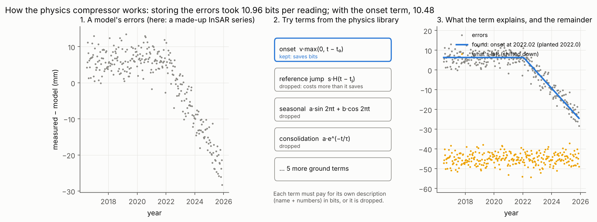
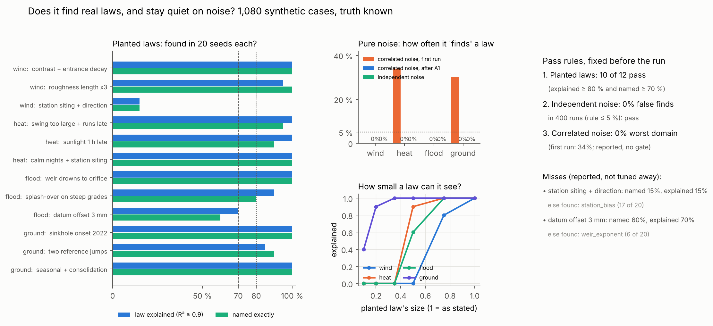
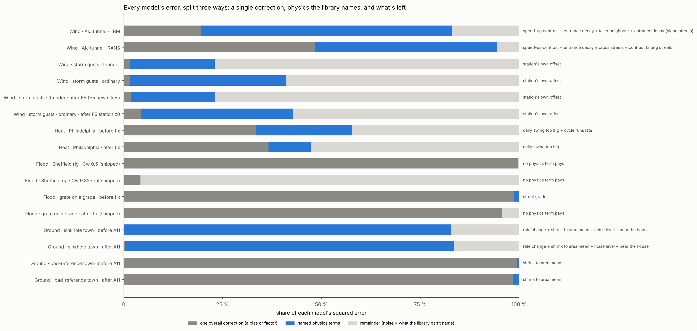
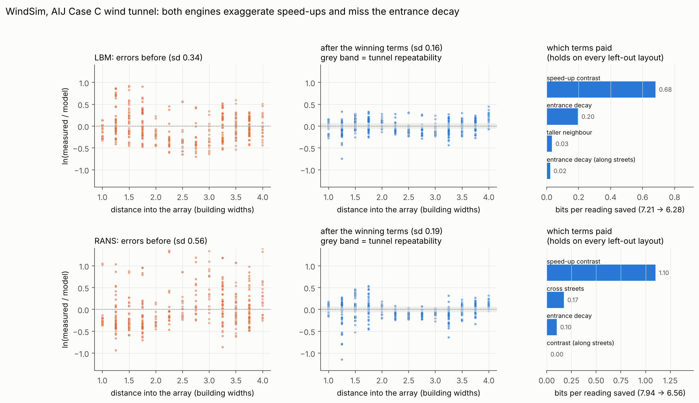
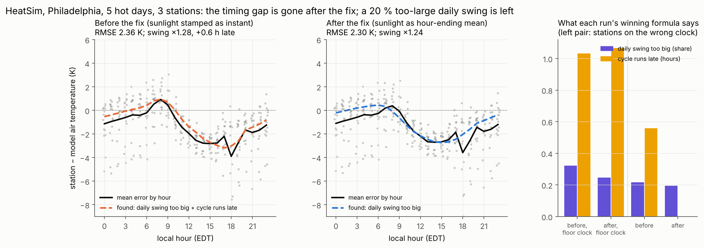
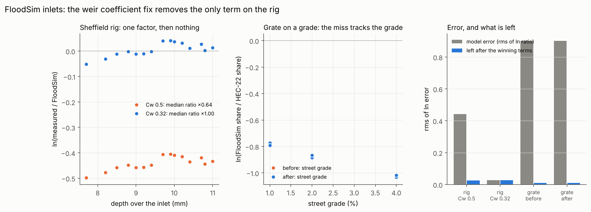
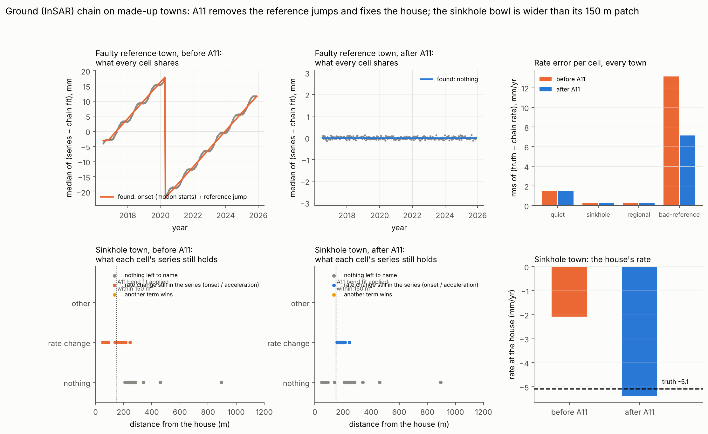
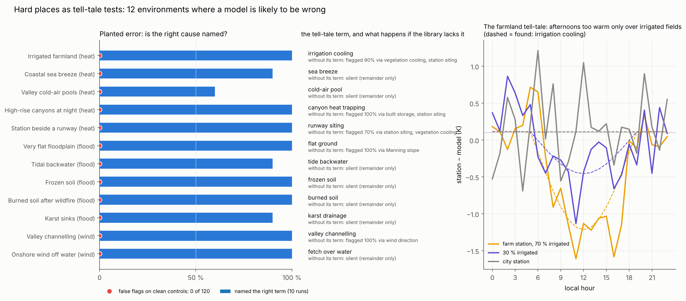

# The physics compressor: a term library, validated, then run on every model (22 Nov 2026)

Protocol: [PROTOCOL-4.md](PROTOCOL-4.md) (pushed before any real case, commit 82e718f; amendments A1 to A3, each
written before the runs they affect). Code: `physlib/` (`engine.py`, `terms.py`, `synth.py`, `validate.py`,
`cases.py`, `envtests.py`, `figures.py`; self-tests `python -m physlib.test_physlib`). Results:
`results/physlib/*.json`. Figures: `physics/figures/library/`.

## What it is
A curated library of known physical terms per domain (wind 19, heat 14, flood 13, ground 16, plus 12 environment
terms for part C), each a formula a model's errors might follow: log-law roughness, displacement, gust factor,
entrance decay; sunlight timing, heat-storage lag, daily-swing amplitude, calm-night decoupling; weir exponent,
weir-to-orifice transition, depth datum, splash-over, Manning slope; InSAR rate offset, seasonal, onset, reference
jumps, consolidation. A beam search tries sparse combinations (up to 5 terms) and keeps the one that stores the
model's errors in the fewest total bits, the formula's own description included. Naming a term costs log2 of the
library size, so a bigger library has to earn each term harder. What no term explains is the remainder.

## A. Does it find real laws and stay quiet on noise? (1,080 synthetic runs, truth known)

- **Rule 2 (independent noise, ≤ 5 % false finds): pass, 0 of 400.**
- **Correlated noise:** the first run named a term in 34 % of heat and 30 % of ground runs (rule 3, expected). A1
  codes ordered residuals as AR(1); after it, **0 of 200**.
- **Rule 1 (planted laws): 10 of 12 pass after A1** (first run: 9). The two misses are results, not tuned away:
  a 0.12 direction effect at noise 0.15 is below what 360 readings can show (the station offset beside it is
  found every time), and a 3 mm depth datum is a near-twin of a different depth exponent over the rig's depth range
  (named 60 %, explained 70 %). The sweep shows the detection limit: about half the stated size for heat and
  ground, three-quarters for wind and flood.

## B. The models, before and after the 22 Nov fixes

**Wind, AIJ Case C (no fix today).** Both engines: speed-up contrast (measured ∝ model^0.45 LBM, ^0.16 RANS) and an
entrance decay (L ≈ 0.8-0.9 building widths), the same two terms PROTOCOL 1 found with a hand-picked list, now
found from a 19-term library. Both transfer to every left-out layout. The terms take the error sd from 0.34 to 0.16
(LBM) and 0.56 to 0.19 (RANS); tunnel repeatability is 0.05. About 0.5 bit per point of neighbour structure is
still left in both (p = 0.01): the library has no term for it (recirculation and flow direction need full-field
output). 

**Wind, Layer 1 storm gusts.** Only the station's own offset pays (coefficient 0.74 thunder, 0.86 ordinary); it
transfers to all 14 left-out places for ordinary storms and fails at Phoenix and Riverside for thunder. Roughness,
gust-factor, elevation, direction, stability and season terms don't pay. Agrees with FINDINGS-3.
**After F5** (WindSim, 23 Nov 2026; each station's z0 from its own gust record, adopted for ordinary storms only;
results 33af0a7 + e41b6c5, 14 calibration places plus 4 new blind ones: Baltimore, Minneapolis, San Diego, Tampa;
built by `physics/layer1_f5.py`): nothing changes. The station's own offset is still the only term that pays, at the
same strength (ordinary 0.32 bits/reading saved, coefficient 0.87, sd 0.17 → 0.14; thunder 0.17, coefficient 0.73).
The roughness term still doesn't pay. So the per-station misses are not roughness as a gust factor sees it. That
matches WindSim's own F5 diagnostic, where variant B barely moved the per-station spread. The station term transfers
at 17 of 18 left-out places for ordinary storms; it fails only at Tampa, which has 37 pairs. For thunder it
transfers at 14 of 16; it fails at Phoenix and San Diego.

**Heat, HeatSim 0.6.1, Philadelphia, 5 days, 3 stations, before and after the sunlight-timing fix.**

- **A2, a clock error in our own earlier scoring.** PROTOCOL-2 put each ISD report in the hour it falls in, but
  routine reports come at :51-:54, so they were labelled almost an hour early. On that clock the compressor finds
  the model "1.0 h late" before and after the fix. With reports rounded to the nearest hour (HeatSim's own rule),
  RMSE drops from 2.83 to 2.36 K, and the lateness is 0.56 h. **FINDINGS-2's "runs ~2 h late" was mostly our clock.**
- **The fix works where it should.** Before: daily swing too big + cycle runs late (0.56 h). After the hour-ending
  fix: **the timing term no longer pays**; only the swing is left (model's daily range about 1.24× the stations').
  HeatSim's own M1 rule (peak-hour lag) failed this fix; the compressor says the timing gap is closed.
- What's left to fix: the swing. It holds on every left-out day and at PHL and NE PHL, and fails at Wings Field (the
  station with trees in its cell), as before. Candidates stay as in FINDINGS-2: ground and grass heat storage, or
  the daytime mixed layer.

**Flood, FloodSim inlets.** 
- Sheffield rig, Cw 0.5: one factor (×0.64), no physics term. Cw 0.32 (42b3d0c): median ratio ×1.00 and **nothing
  pays at all**. Calibration (0.32 was fitted to these tests), so it checks the fix landed, nothing more. FIXES-3
  (FloodSim 6f9122f) kept Cw 0.5 as the default, so the shipped model still reads ×0.64 low on this rig.
- Grate on a grade: before, street grade cuts the error spread from 0.14 to 0.01 (log units): the model's capture
  misses track grade. **After** (FIXES-3, FloodSim 6f9122f, grate capture on with Cw 0.5, results
  2026-11-22T23-09-22-725Z): **the grade term no longer pays; nothing does.** What is left is one level: shares about
  10 % below HEC-22 everywhere (0.60-0.83 against 0.69-0.91), within each row's pass limit. The 42b3d0c run (Cw 0.32)
  gives the same shares to 4 decimals, so Cw does not touch the grate.

**Ground chain, synthetic towns, before and after CHI A11.** 
- Faulty reference: before, what every cell shares is a reference jump (−39.5 mm in 2020.3) plus a ramp; the rate
  offset is +13.1 mm/yr. After A11's step check: **nothing left in the shared series**, and the offset falls to +7.07,
  the planted −7 that only a GNSS tie can remove.
- Sinkhole: the house rate goes from −2.1 to −5.4 mm/yr (truth −5.1). Cell by cell, **within 150 m the series
  holds nothing more; from 150 to 250 m a rate change is still in every series.** The bowl is 250 m wide and A11's
  after-onset patch is 150 m. Lead for CHI: size the patch from the detected change, not a fixed radius.

## C. Hard environments as tell-tale tests (A3)

Twelve places where a model is likely to be wrong, each error planted on realistic inputs, 10 seeds: **11 of 12
flagged and named in ≥ 90 % of runs; 0 false flags in 120 clean controls.** The farmland bias shows as afternoons
too warm only over irrigated fields, and the irrigation-cooling term names it every time. The cold-air pool (about
0.5 K) is below what 5 days at 6 stations can show (60 %).
With its term taken out of the library, half the environments go silent (only a remainder) and the rest are
picked up by a stand-in (canyon heat by built-surface storage, flat floodplain by Manning slope, valley channelling
by wind direction, farmland by vegetation cooling). So a library gap shows as either a stand-in or a remainder:
the next step is a remainder test by site (does what's left differ between places?) so a silent miss still raises
a flag.

## Limits
Nothing here validates or changes a model; each lead goes to its own repository's protocol. Heat has 3 stations
that feed ERA5. Flood grade and ground score against references and planted truth, not measurements. Part C's
environments are planted, so they show what the tool can see, not that these errors exist in our models.
