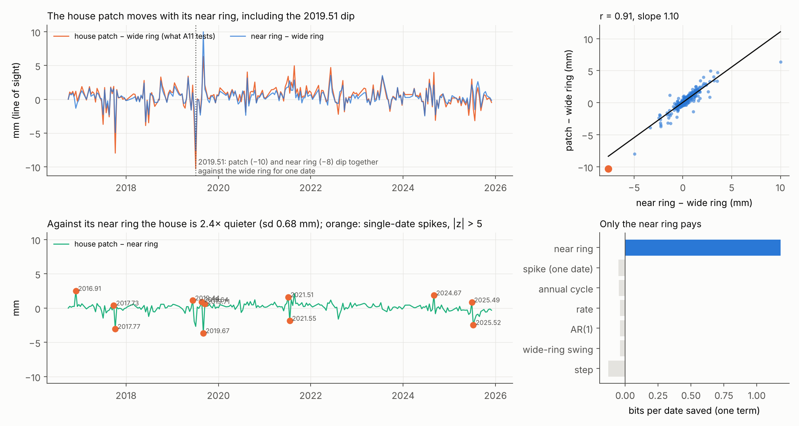

# The Philadelphia house patch against its rings, real InSAR (23 Nov 2026)

Protocol [PROTOCOL-4.md](PROTOCOL-4.md), pushed before any fit (9376578). Script `physics/phl_patch.py`, figure
`physics/figures4.py`, result `results/physics/phl_patch.json`. Data: CHI `data/derived/PHL-POC-001/ground/series.json`,
DISP-S1 line of sight after A11, 250 dates (4 dates blanked by A11 as bad are left out).

## Answers
1. **The 2019.51 date is not the house.** That date the patch reads 4.3 mm and the near ring 7.0, against 16.1, 14.6
   and 20.4 for the wide ring on the dates around it. The patch and its near ring (100–500 m) dip together, by −10
   and −8 mm against the wide ring. Against its near ring the patch is only −2.7 mm off (z −4.5, below the 5 rule).
   So it is a one-date signal over the whole 0–500 m area: an atmospheric cell or a processing artefact at that
   acquisition, not ground motion at the house.
2. **One term pays in patch − wide ring: the near ring.** Patch − wide = 1.10 × (near − wide) + noise
   (r = 0.91). That saves 1.18 bits per date, holds first half → second half and back, and cuts the spread from 1.62
   to 0.69 mm. Nothing else pays alone:
   - The annual cycle pays nothing. Its best phase in patch − near is late July, where rowhouse heat expansion would
     put it, but the amplitude is 0.2 mm, too small to pay.
   - The rate, a step, AR(1), and the wide ring's own swing (common-mode leak) pay nothing either.
   - The neighbour test on the previous two dates finds no time structure (p = 0.26).

   After the near ring, a one-date spike at 2019.67 pays a little. That is the patch's own sharpest blip.
3. **Yes, a single-date spike test should come before the step test,** but run it on patch − near ring:
   - Patch − wide is heavy-tailed. Three dates exceed |z| 5 (2017.77, 2019.51, 2024.67) where Gaussian noise would
     give a largest |z| of about 3.5. Most of that tail comes from the 0–500 m area moving against the wide ring, not
     from the house.
   - Patch − near is 2.4× quieter (sd 0.68 mm). Its own blips (2019.67 at z −11, 2017.77, 2021.55) are dates where
     the patch's few cells jump alone, which is the small-cell-count case. A spike rule there (date against the
     mean of its two neighbours, robust sd, |z| > 5) flags these one-date blips and leaves real steps alone.

## Lead for CHI (GROUND-POC-PLAN)
Read differential motion at the house against the **near ring**, not only the wide ring. It removes most of the
noise the wide ring brings, so the house's own signal is easier to see. The caveat: a bowl wider than 100 m moves the
near ring too and would cancel out, so keep near − wide ring as a separate "is the neighbourhood moving" reading.
Two readings, each with its own spike test, cover both cases. Nothing here changes a reported figure.
