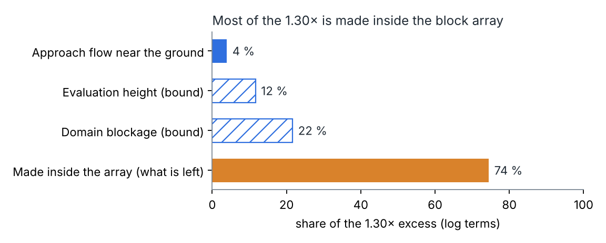
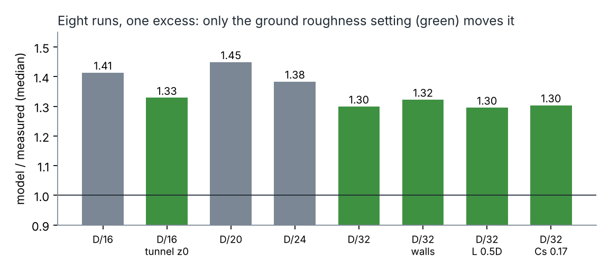
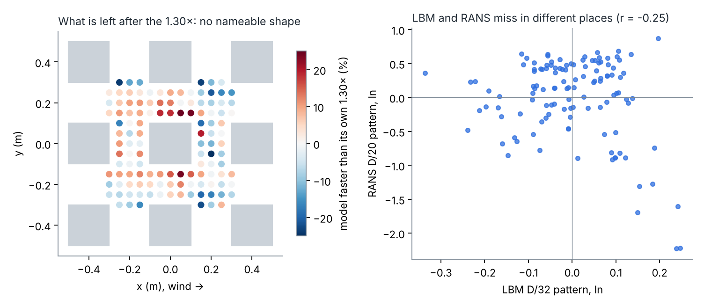

# Findings 5: where WindSim's 1.3× street excess on AIJ Case C comes from (23 Nov 2026)

Protocol: `PROTOCOL-5.md` (written before any fit; A1 after the synthetic check, before the real fit). Script:
`physics/aij_c_bulk.py`, results `results/physics/aij_c_bulk.json`, figures `physics/figures/bulk_*.png`.
Data: WindSim bf9e352, eight LBM runs of Case C 1D (D/16 to D/32, the F3 candidates included) and RANS D/20.

## The answer in one line
About three quarters of the 1.30× is made inside the block array. It does not move with resolution, the wall
model, the inflow eddy size or Cs. Of every setting tried, only the ground roughness moves it (by about 8 %). It has
no street-by-street shape that the vocabulary can name at a 4 to 6 % level, and RANS does not share it.

## Synthetic check (A1)
- Uniform factor only: no term named in 10 of 10. Point pattern + resolution shift on the 8-run pool: 10 of 10. **Pass.**
- Power (A1): the smallest effect named in 8 of 10 is sd 0.04 (ln) for `canyon_along` and 0.06 for `lateral` and
  `near_wall`. `fetch_decay` is below 8 of 10 even at 0.06. So "does not pay" below means "smaller than about 4 to 6 %
  across the points".

## Ranking

| Suspect | Evidence | Share of ln 1.30 | Verdict |
|---|---|---|---|
| **Made inside the array** | 1 − S1 − S3 bound | **≥ 74 %** | **the main cause** |
| S3 domain blockage / fixed top | 5.6 % frontal blockage of the model's 1.8 × 1.2 m section; `lateral` does not pay | ≤ 22 % (bound) | a part, at most |
| S2 evaluation height 0.02 m | local slope d lnU/d ln z ≤ 0.21 (side street), half-cell height error | ≤ 12 % (bound) | a part, at most |
| S1 approach flow near the ground | model upstream 2.44 to 2.47 m/s at 0.02 m against 2.43 measured | 4 % | ruled out |
| S4 settings | pool of 8 runs: `point_pattern` (δ = 0.96) + `z0_tunnel` (+0.077 in ln) chosen, transfers on all 8 leave-one-run-out folds; `res`, `walls`, `L05`, `cs17` do not pay | | ground z0 contributes; the rest ruled out as level movers |
| S5 street-scale mechanism | D/32 mean of 4 runs: one factor is the best code; single runs pick different pairs (contrast + lateral, contrast + corner, none, none) | | does not pay (below the MDE) |
| S6 shared with RANS | point patterns correlate −0.25 (shared measurement noise alone gives +0.06); levels LBM ×1.30, RANS ×0.54 | | not shared |
| S7 unnamed structure | neighbours still save 0.19 bit per point, p = 0.005 | | present |

## What this means for the next fix
- The excess is set by something every LBM run shares and the RANS model does not. It is not the inflow at the
  ground, not the measurements and not a street-scale mechanism of 4 to 6 % or more. The only lever that moved it is
  the ground: a rougher floor (tunnel z0) took off 8 %. **The first suspect to test is the floor inside the array**:
  the log-law wall function applied to the street floors, where the flow is recirculating or not in
  equilibrium. Test: one run with the floor's wall function replaced inside the array only (for example a no-slip
  floor resolved by the D/32 cells, or a floor z0 from the street-floor finish), keeping everything else.
- **Second, the domain**, worth up to 22 %: one run with a wider and taller section (blockage under 2 %), all else
  fixed. A cheap check first: the AIJ tunnel's own cross-section, if published, against the model's.
- **Third, the evaluation height**, at most 12 %: the sampler's interpolation at 0.02 m against the cell centres
  (3 and 4 above the floor). Can be read from the existing mean field with no new run.
- The 0.96 point pattern repeats from run to run (mean correlation 0.91 between the four D/32 runs), and about a
  third of its variance is the measurement noise floor. The rest is deterministic and unnamed. The words still
  missing are the ones protocol 1 listed: flow direction, recirculation and local turbulence. They need the
  model's full mean field at 0.02 m, not only the point speeds. Post hoc only, not a finding: by street type the
  pattern reads along-wind streets +6 %, cross streets −5 %, intersections 0 %, below the MDE.

## Limits
- Case C 1D is calibration for every run here; nothing is validated. Any fix goes through WindSim's protocol and a
  held-out case (B or D).
- S2 and S3 are bounds, not measurements. The blockage bound is the frontal blockage of the model's section, not a
  computed effect, and the tunnel's own section is not known here.
- The pool's rows share the measurements point by point, so `point_pattern` carries the measurement noise too.
  That is why it reads "something every run shares", not "the model".
