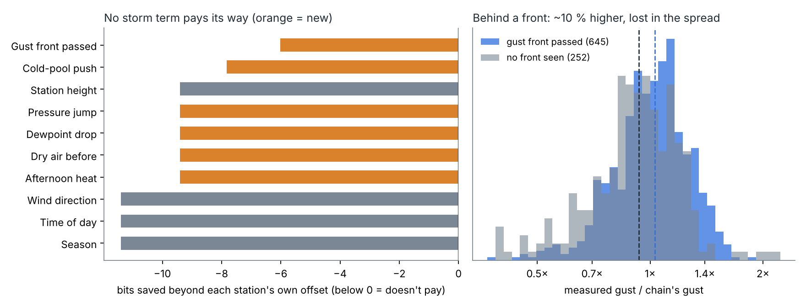

# Findings 6: storm physics and WindSim's thunderstorm gust misses (24 Nov 2026)

Protocol: `PROTOCOL-6.md`, written before any storm weather was read. Scripts: `physics/storm_terms.py` (terms from each
station's own ISD record), `physics/storm_search.py` (search), `physics/figures6.py`. Results: `results/physics/storm_terms.json`,
`storm_search.json`.

## The answer
**A null.** None of the storm terms explains the thunderstorm misses beyond each station's own offset. That covers the
cold-pool push (temperature drop across the front), the pressure jump, the dewpoint drop, dry air under the cloud and
afternoon heat. The best formula is still the station offset alone, as in protocol 3. It transfers from calibration to blind
and on 11 of 13 place folds.

## Data
- 903 thunderstorm pairs. 897 had storm weather; 99.7 % of gusts were found in the record at the reported speed.
- 71 % of the gusts carry a gust-front signature: a temperature drop of 3 K or more and a pressure jump of 1 hPa or more within 90 min.
- Missing values: ΔT 63, Δp 45, ΔTd 101, dryness 97.

## Synthetic check: passes
- With station offsets only, no storm term was named in 10 of 10 seeds.
- Smallest effect found in 8 of 10: sd 0.06 (ln) for `cold_pool` and `gust_front`.
- The noise left after station offsets is sd 0.20.

## Real result
- Every storm term has the sign the physics expects. Coefficients beyond the station offset:
  - `cold_pool` +0.52 per unit of sqrt(ΔT/T);
  - `gust_front` +0.075, so gusts behind a front read about 8 % above the chain's;
  - `pressure_jump` +0.015 per hPa.
- Each is below the minimum detectable effect, so none pays for itself.
- By group, the median measured/chain ratio is 1.03 behind a front and 0.93 with no front seen. The 10th-90th range is 0.74-1.33 behind a front against 0.61-1.23 without.
- The contrast is too small next to the scatter (sd 0.20) to narrow the range.
- No term contributes, so the range reading stays the single range. On this blind set (F2 places) it covers 78.6 %, inside the 70-90 % mark.

## What it means
- The thunderstorm noise is not missing weather the station saw. It matches WindSim's own T1 finding: thunderstorm gusts vary over less than the airport spacing.
  - A downburst is a few kilometres wide, and an anemometer catches whichever part passes over it.
  - The honest product answer remains a range, not a sharper number.
- **Post hoc, not a finding:** gusts with no front seen have a fatter low tail (10 % below 0.6× against 3 % behind a front).
  - These are plausibly storms whose core missed the station.
  - A future protocol could test an asymmetric range, or drop "thunder heard but no front" gusts from the calibration of the range.
- Step 2 (NEXRAD radar, GOES) was gated on a step 1 term paying. None did, so it is not started.
- Radar could still help for a different reason: placing the downburst core relative to the house, which no station can do. That is a new question, not this protocol's.

## Limits
- Hourly and special reports only, so a fast temperature drop can fall between rows.
- One station per gust.
- ERA5 terms (CAPE, storm motion) are not tested. No CDS key is set up here; they need an amendment before any value is read.
