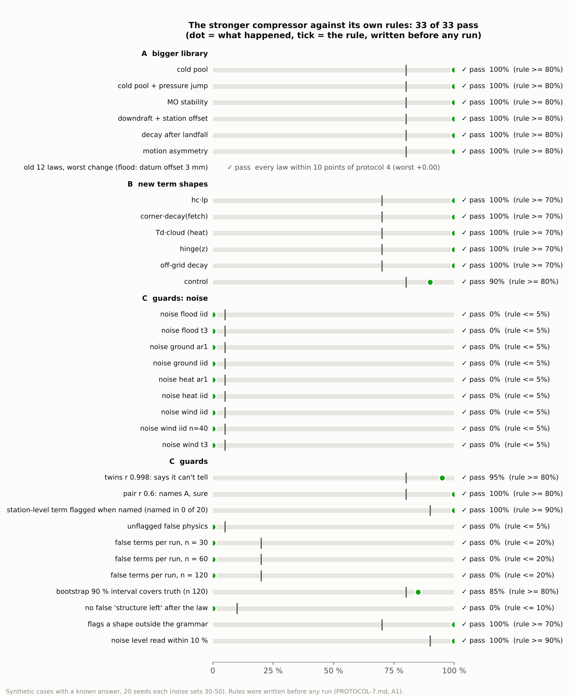
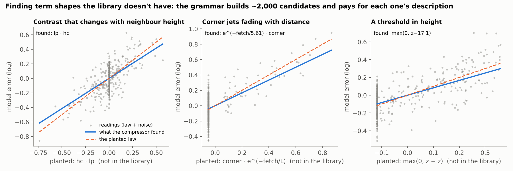
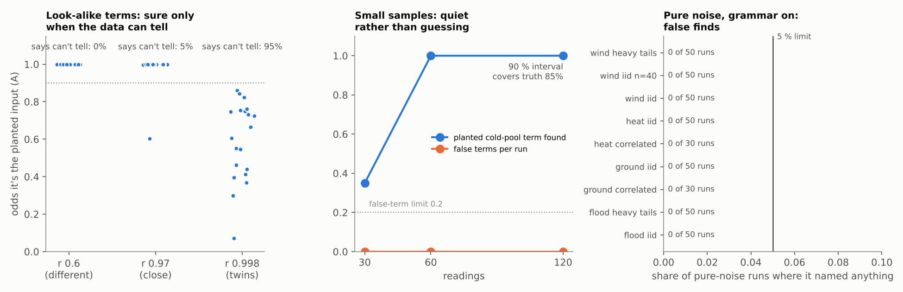
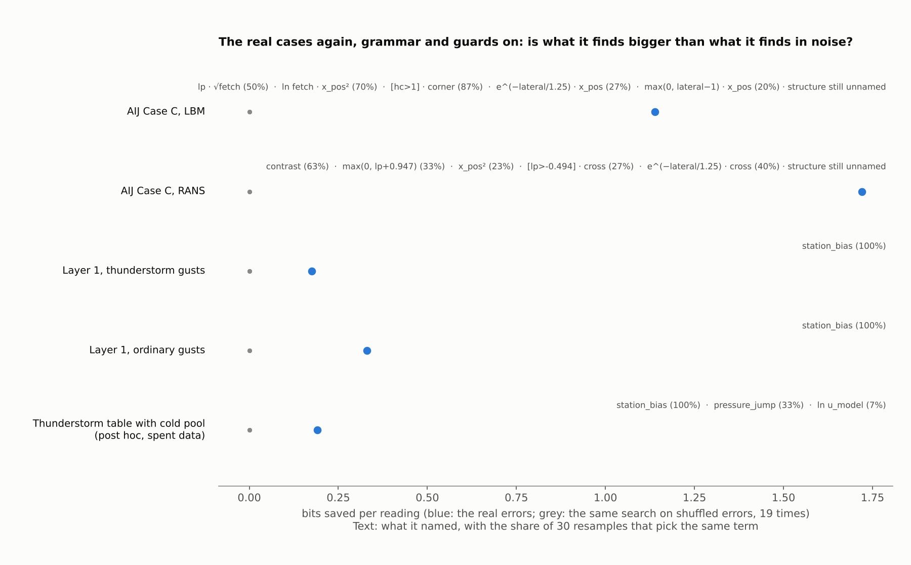

# Protocol 7 results: a stronger physics compressor (24 Nov 2026)

Protocol: [PROTOCOL-7.md](PROTOCOL-7.md) (pushed before any run of the new code, 0bf3394; amendment A1 before any
protocol seed, after smoke runs on seeds ≥ 90000). Code: `physlib/grammar.py`, `physlib/guards.py`, v2 changes in
`engine.py` / `terms.py` / `synth.py`, `validate7.py`, `cases7.py`, `figures7.py`. Results: `results/physlib/v7_*.json`.
Self-tests: `python -m physlib.test_physlib` (7 pass). Internal research engine; nothing here is for the website.

## What changed
- **Library:** wind 19 → 35 terms (11 convective and stability, 5 tropical-cyclone), heat +3. Forms written from
  memory; no source paper was opened, so no constant is quoted from one: every constant is free.
- **Grammar:** from a case's raw inputs it builds 2,000 to 8,000 candidate shapes (one input under log, √, square,
  1/x, decay, hinge or step; or a product of two). Each costs its own description in bits, so a library term wins a
  tie. A grammar winner says "the errors follow this shape"; naming the mechanism stays a human step.
- **Guards:** look-alike swaps (odds 10:1), approximate posterior odds per term and per input, group-level check,
  bootstrap (selection share and 90 % coefficient interval), a null search on shuffled errors, a neighbour test for
  structure no term named, and a heavy-tail residual code.

## A to C: the planted-law tests: 33 of 33 rules pass

- **A, bigger library:** all six new laws (cold pool, cold pool + pressure jump, MO stability, downdraft + station
  offset, decay after landfall, motion asymmetry) named and explained in 20 of 20 seeds. The landfall decay rate is
  recovered as a family parameter.
- **A-reg, the PROTOCOL-4 laws:** none got worse with the library nearly doubled. One got much better: the "station
  siting + direction" law, named in 15 % of seeds under PROTOCOL-4, is now named in 100 %. **FINDINGS-4's reason for
  that miss ("below what 360 readings can show") was wrong.** The cause was a bug: some formulas scored NaN, and a NaN
  in the beam's sort scrambled which formulas went forward. v2 scores them +∞ (A1). Re-running FINDINGS-4's real
  cases with the fixed engine (grammar off) gives the same winners as before (AIJ C both engines, Layer 1 all four
  sets), so no real-case conclusion moves.
- **B, shapes the library doesn't have:** an interaction hc · lp, a gated decay corner · e^(−fetch/L), a moisture-
  under-cloud product (heat), a hinge in height, and an off-grid decay length: the right shape (|r| ≥ 0.95) in 20 of
  20 seeds each. With the planted law in the library, the library names still win (18 of 20; twice ln fetch stood in
  for the decay, which the look-alike guard reports).
  
- **C, guards:** 
  - Pure noise with the grammar on: **0 false finds in 410 runs** (iid, correlated, heavy-tailed, and n = 40). The
    grammar's description cost (13 to 18 bits a shape) is about log2 of how many shapes there are, which is why.
  - Look-alikes: twins at r = 0.998 (a swap costs < 1 bit): says it can't tell in 19 of 20. At r = 0.97 the data
    can tell (a swap costs ~15 bits), and it names the right one, sure, in 19 of 20. A1 changed the twin r after the
    smoke run showed 0.97 is tellable; the rule did not change.
  - Group confounding: with siting offsets at 6 stations, the station-level attribute with no effect was **never
    named** in the 20 protocol seeds (the offsets won every time), so the new group-level check was not exercised
    there. It flagged both cases in the smoke runs. It does not flag the real Layer 1 station term (104 and 118
    stations; it pays 170-6,000 bits at the group level).
  - Small samples: no false term at n = 30, 60 or 120; the planted cold pool is found in 35 % at n = 30 and 100 %
    from n = 60. The bootstrap 90 % interval covers the planted coefficient in 17 of 20 (rule ≥ 80 %).
  - Unnamed structure: after a named law, no false alarm (0 of 20). A shape outside the grammar (sin 3lp · cos fetch)
    is flagged in 20 of 20 and located on the right pair of inputs (lp × fetch) every time, while nothing is named.

## D: the real cases again (exploratory; not tests)

- **AIJ Case C, LBM D/10.** The grammar replaces FINDINGS-4's four library terms with five shapes and takes the error
  sd from 0.34 to **0.094** (FINDINGS-4: 0.16; tunnel repeatability 0.05). It beats every one of 19 shuffled runs and
  transfers to every left-out layout. But the shapes are not stable: each is picked in 20-87 % of resamples. What
  is stable is the inputs: speed-up (lp), distance into the array (fetch, x), **distance from the centreline
  (lateral)**, and corners behind taller blocks (hc, corner), all with inclusion odds ≈ 1. Lateral position was
  protocol 5's blockage suspect (S3); it now shows up as an interaction with x. The neighbour test still finds
  structure (hc × lateral, p 0.01). Read: the LBM's Case C error has a pattern in lateral position along the array
  that the library has no word for; the exact form is not pinned down.
- **AIJ Case C, RANS.** Keeps the contrast term (picked in 63 %), adds four shapes, sd 0.375 → 0.094, but **does not
  transfer to the 2D layout when it is left out** (FINDINGS-4's library formula did). Over-fitted to the layouts; the library
  formula stays the better summary for RANS.
- **Layer 1, thunderstorm and ordinary.** Unchanged: the station's own offset only (picked in 100 % of resamples,
  passes the group-level check), nothing from the grammar, no structure left. Thunderstorms still fail to transfer
  at some places (as FINDINGS-4).
- **WindSim protocol 6's thunderstorm table (897 gusts, spent data, post hoc).** Station offset plus a pressure-jump
  term (+0.12 per √(2Δp/ρ)/U, 90 % interval 0.09 to 0.16) and ln U_model (the chain's strongest gusts are a little
  high). But the error sd stays 0.188, the same as the station term alone; pressure jump is picked in only 33 % of
  resamples (cold pool 37 %); it doesn't transfer at Denver and Riverside. **Agrees with WindSim's FINDINGS-6: no
  storm term earns a place.** Pressure jump vs cold pool is a lead for a blind test on the A3/F5 places, nothing more.

## What this does and doesn't mean
- The compressor now finds shapes outside its library on synthetic data and stays silent on noise, at the sample
  sizes and signal sizes tested (signal-to-noise 1). A weaker signal is found less often (detection curve in C4).
- On real data the grammar can over-fit the layouts it is given (RANS) and can pick unstable shapes (LBM). The
  bootstrap share and the left-out transfer are what separate a lead from a fit: read them before any shape.
- "Finds variables in patterns of noise" is right in this sense only: it finds which inputs the errors depend on and
  says how sure it is. It cannot find an input nobody measured, and a shape it finds is a description, not a law.

## Next
1. The LBM's lateral pattern: a WindSim run that writes the near-wall and lateral flow at the Case C points, then a
   library term with a physics name for it (blockage or side-wall channelling) instead of a shape.
2. Storm terms on the blind A3/F5 places (WindSim owns the extraction), with DCAPE and lapse rate once a reanalysis
   source is reachable.
3. A symbolic search one level deeper (three-factor shapes) only with a protocol that tests its false-find rate first.
