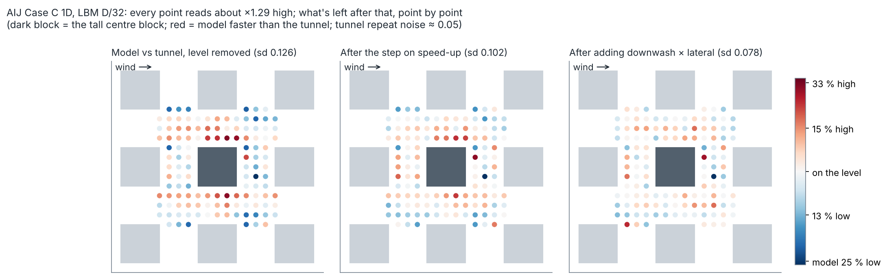
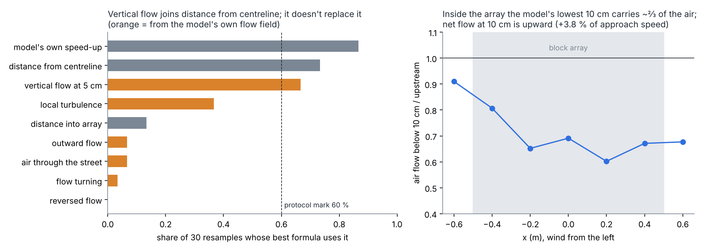

# Findings 8: can the LBM's own near-ground flow name its lateral Case C pattern? (24 Nov 2026)

Protocol: `PROTOCOL-8.md` (a174b06, written before the field was read). Script: `physics/lateral_fields.py`, results
`results/physics/lateral_fields.json`, figures `physics/figures8.py`. Data: WindSim F3 step 5 (Case C 1D, D/32, walls off,
z0 0.0003, L 0.5 D, Cs 0.12, run on THE-COW 24 Nov, 3.6 h): `results/physics/f3s5_fields.npz` and the run's 120 points.

## The answer in one line
No. The lateral pattern comes back in this run, and the model's vertical flow at 5 cm adds to it. But no flow word
replaces distance from the centreline, and none of them touches the ×1.29 level. Inside the array the model's lowest
10 cm carries only about two thirds of the upstream air, with net flow upward at 10 cm. So the excess is not extra air
fed down into the lower layer.

## Synthetic check (passed)
- No planted term: no field term named in 10 of 10 (rule: 9 of 10).
- Power, the smallest effect named in 8 of 10: 0.06 sd (ln) for `side_flux` and 0.08 for `street_flux`. "Doesn't pay"
  below means smaller than about 6 to 8 % across the points.

## Readings

| | Run A: FINDINGS-7 inputs | Run B: + flow terms |
|---|---|---|
| Formula | level + step on the model's own speed-up | same + vertical flow at 5 cm × lateral |
| Error sd (ln), from 0.125 | 0.102 | **0.078** (tunnel repeat noise ≈ 0.05) |
| Inclusion of lateral | 0.81 | 0.98 |
| Quadrant folds that transfer | 4 of 4 (and upstream → downstream) | 4 of 4 (and upstream → downstream) |
| Null search p | 0.05 | 0.05 |
| Structure left (neighbour test) | fetch × lateral, p 0.01 | vertical flow × street flux, p 0.01 |

- **Q1, does the lateral pattern recur? Yes**, by the protocol's rule (inclusion 0.81 ≥ 0.8, 4 of 4 folds). It is
  weak on resampling, though: only 47 % of bootstrap winners use lateral in run A.
- **Q2, does a flow term name it? No.**
  - The vertical flow at 5 cm (`downwash`, w / U_app, positive upward) enters with inclusion 0.99 and transfers on all
    folds, but lateral stays at 0.98. By the protocol, that is "adds to", not "names".
  - The bootstrap share was counted per input, the way protocol 7 A1 counts inclusion: 67 % of resamples use the
    vertical flow in some shape. That choice was made after seeing the per-term share, which is spread over several
    look-alike shapes with a top share of 17 %. Under the strict per-term reading, no flow term pays at all. Either way,
    the answer to Q2 is no.
  - The form isn't pinned. `downwash · lateral` can't be told from `max(0, downwash − 0.01) · lateral` or
    `downwash · √lateral` (within 2 to 3 bits). Its sign: away from the centreline, where the model's air rises, the
    model reads less high.
- **Flow turning, reversed flow, outward flow, air through the street:** none paid. On their own, local turbulence
  (13 bits) and flow turning (8 bits) save something, but the step on speed-up takes their place.

- **Level ledger (described, not gated):** this is the air flowing through the whole section below 10 cm, divided by
  the same flow upstream.

  | x (m) | Q / Q₀ | where |
  |---|---|---|
  | −0.6 | 0.91 | upstream |
  | −0.4 | 0.81 | |
  | −0.2 | 0.65 | |
  | 0 | 0.69 | |
  | +0.2 | 0.60 | |
  | +0.4 | 0.67 | |
  | +0.6 | 0.68 | behind |

  The plan-mean vertical flow at 10 cm over the array is +3.8 % of the approach speed, upward. In the model, air
  leaves the lower half of the canopy; none comes down into it. The tunnel's flux isn't known, so this says how the
  model's flow is arranged, not that the tunnel's differs.

## What this means for the next fix
- Every point-level word tried so far now accounts for about 0.05 of scatter in ln. The ×1.29 is a level, and the
  near-ground flow doesn't explain it. With FINDINGS-5 (≥ 74 % made inside the array) and D1 (flow above the array
  10–13 % fast), the open suspect is what happens at and above roof height. That is how the model's shear layer over
  the blocks sets the speed the streets see. This field stops at 10 cm, half the block height.
- **Next run:** the same F3 setting with `--keep-fields 0.45`, so the field reaches above the tall centre block.
  Then a ledger of momentum flux at roof height (u'w' cannot be read without covariances; `write_fields` would need
  uw, vw and uv sums added, which is a WindSim change under its own protocol).
- The domain-blockage test (FINDINGS-5 second suspect, ≤ 22 %) stays open and is cheap to add to the same run:
  widen the section so blockage falls under 2 %.

## Limits
- One run, one layout, 120 points; the folds are spatial, and the mirror fold makes the quadrants share field
  values pairwise.
- `ti_local` is the isotropic form, because covariances aren't stored.
- The flow terms come from the same model whose error they explain.
- The street flux for cross streets uses the outward v flux. That is a reading of "air through the street" made while
  writing the script, before any value was read.
- Nothing here changes WindSim's score; a fix goes through WindSim's protocol and a held-out case.
