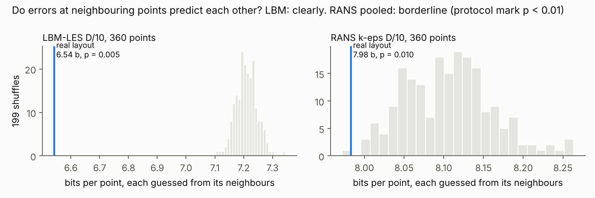
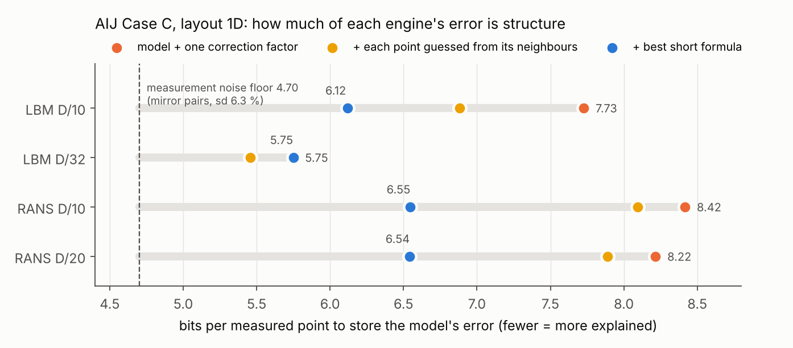
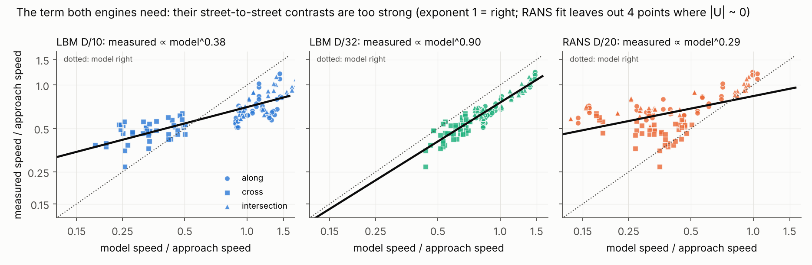
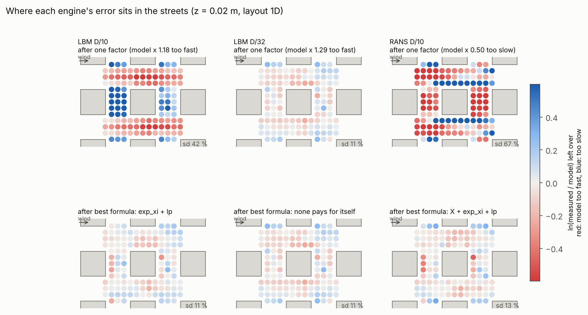
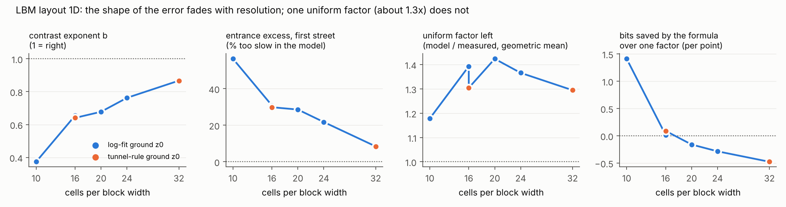

# Can the compressor find the physics our models are missing? (22 Nov 2026)

**Short answer: yes, in a narrower sense than "discover physical laws".** Code length can tell three things apart:
1. whether a model's errors against measurement have structure at all, or are measurement noise;
2. which short formula, from a vocabulary we supply, captures that structure, and whether it pays for its own
   description (minimum description length, MDL);
3. how many bits of structure are left that nothing in the vocabulary can name. That remainder is the honest
   pointer to "something we have no word for yet".

It cannot invent a mechanism the vocabulary lacks, and a formula fitted to one benchmark is a diagnosis, never a
correction for reports. The method is the scoring rule behind symbolic regression and SINDy-style term selection;
codelen makes every bit checkable with a real arithmetic coder (round trip asserted on every winner).

Protocol, written and pushed before any real residual was fitted: [PROTOCOL.md](PROTOCOL.md) (amendments A1, A2).
Code: `codelen/lawsearch.py` (tests: `python -m codelen.test_lawsearch`), `physics/aij_c.py`,
`physics/aij_c_posthoc.py`, `physics/figures.py`. Results: `results/physics/`. Data: WindSim `3c780ff`,
AIJ Case C per-point files. CPU only, about 8 minutes.

## Step 0: the tool finds laws we planted (pass)
On Case C's own geometry and the LBM predictions:
- Planted r = −0.10 − 0.35·A·exp(−ξ/1.5) + noise: ranked first out of 3,174 formulas, with L = 1.57 and a
  coefficient of −0.29 (marks: 30 % and 20 %).
- Pure noise around a constant: "one correction factor" ranked first, so no formula was invented.
- Measured = √(U² + α·2k) × noise with α = 2/3 on the RANS fields: recovered α = 0.65.

## Step 1: WindSim's errors have structure

Each point's error is guessed from its already-coded neighbours, and compared with 199 shuffles of the same errors.
- **LBM-LES D/10:** 6.54 bits per point against 7.21 ± 0.04 shuffled (p = 0.005). Structure is present.
- **RANS D/10, pooled layouts:** 7.98 against 8.11 ± 0.05 (p = 0.010). This is borderline, because the protocol's
  mark is p < 0.01. Post hoc, each RANS layout on its own reaches p = 0.005.
- **Noise floor:** measured speeds at mirror-image points (x, y) and (x, −y) differ by 6.3 % (sd, 171 pairs). On
  this grid that is 4.70 bits per point. The errors sit 1.5 to 3.7 bits above it.

## Steps 2 and 3: the formulas, and whether they transfer to an unseen layout

| Engine (360 points) | One factor | Best formula | Formula, ln(measured/model) = | Hold-out (fit on 2 layouts, code the 3rd) |
|---|---|---|---|---|
| LBM-LES D/10 | 7.21 b | **6.30 b** | −0.52 + 1.26·e^(−ξ/0.84) + 0.08·h_c − 0.58·ln(model/approach) | beats one factor on 0D, 1D and 2D |
| RANS k-ε D/10, \|U\| | 7.94 b | **6.51 b** | −0.02 − 0.62·ln(model/approach) − 0.095·X·ξ + kfrac(α = 0.06) | beats one factor on all three |
| RANS, √(\|U\|²+2k) | 7.04 b | 6.38 b | −0.04 − 0.55·ln(model/approach) − 0.09·X·ξ + 0.16·lee | beats one factor on all three |

ξ is the distance into the array in block widths, X marks cross streets, and h_c is the centre-block height.
The coder check on the LBM winner gives 2,168 coded bits against 2,160.6 ideal, and the round trip is exact.

**Both engines need the same two terms, in the same direction:**

1. **A contrast law: measured ∝ model^b, with b well below 1.** The LBM gives b = 0.38 at D/10, and RANS gives
   b = 0.2 to 0.4. Each engine makes its fast streets too fast relative to its slow ones. Physically, momentum is
   not being mixed between the along-wind streets, the cross streets and the block wakes.
2. **An entrance term, e^(−ξ/L) with L ≈ 0.8 to 0.9 block widths.** The real array brakes the flow within about
   one block of its front. Both models keep the speed deeper into the array.

The RANS turbulence term `kfrac` comes out at α ≈ 0.06 to 0.1, not the 2/3 that isotropic theory gives (the
planted test shows the tool can recover 2/3). Adding k to |U| does help on its own: one factor drops from 7.94
to 7.04 bits. But once the contrast law is in the formula, k has almost nothing left to explain. The thermistor
argument is real, but it is not RANS's main problem.

## Step 4: in the LBM the shape is resolution; a single factor remains

The LBM winner's terms were refitted on layout 1D at each resolution:
- **The contrast exponent b** goes 0.38 → 0.65 → 0.68 → 0.76 → 0.87, from D/10 to D/32.
- **The entrance excess at the first street** goes 56 % → 30 % → 28 % → 22 % → 8 %.
- **From D/20 on, the formula no longer pays for itself.** At D/32, one correction factor is the best code
  (5.75 bits per point) among every formula of up to three terms, so the error has no shape left that the vocabulary can name.

A judgement call to declare: the protocol labels each term by its *coefficient*. The entrance coefficient grows
(1.65 → 4.4) while its length L shrinks (0.76 → 0.25 D), so that coefficient alone would read "persistent". Its
effect at the first street, shown above, falls by 85 %. Both readings are reported here. The label "resolution"
rests on the effect.

**RANS:** the same search at D/20 gives the same formula and nearly the same coefficients as at D/10 (b ≈ 0.1 to 0.2 on layout 1D,
entrance L ≈ 0.8). The RANS shape is **persistent**, so it comes from the steady model itself, as WindSim's own
model-swap runs found. Step 5's rule ("same sign in both engines, so a shared cause") is therefore not supported:
the two engines get the same shape for different reasons.

## What is missing, by this measure
- **LBM at D/32:** the model is **1.29 × too fast**, almost uniformly. Street type, distance into the array and
  centre-block proximity add nothing that pays for itself. A uniform excess points at something that acts on the
  whole array at once: the flow delivered near the ground (inflow turbulence, its spectra), the canopy-top shear
  layer's drag, or the 0.02 m evaluation height. A street-by-street mechanism is not supported.
- **Something still unnamed:** at D/32 the neighbour test still finds structure (5.46 against 5.78 bits shuffled,
  p = 0.005). That is 1 bit per point above the noise floor, and no formula in this vocabulary captures it. The
  vocabulary has no flow direction, no near-wall distance in z, no local turbulence and no recirculation flag.
  Those are the next words to add, and they need the model's full fields, not only the point speeds.
- **RANS:** a steady model's contrasts are too strong at every mesh. More tuning will not fix that, which agrees
  with WindSim's conclusion to move to scale-resolving simulation.

## Limits
- Case C was already used for diagnosis and calibration, so nothing here is validated. A term becomes a model
  change only through WindSim's own protocol and a held-out case (B or D).
- 120 to 360 points, one wind direction and one height. The mirror-pair floor also contains tunnel asymmetry.
- The ln(model) term is fitted against a model output that carries 6 to 14 % averaging noise. That pulls b down
  slightly (errors in variables). It is small next to b = 0.38, but not next to b = 0.87.

## What the transformer adds
A neural compressor, such as the gridzip transformers or a TabPFN-style predictor, can stand in for the
"guessed from its neighbours" coder. That gives a tighter **upper bound on how much structure exists**, though it
does not say what that structure is. The pairing that works is: a neural coder measures how much is left, and
the MDL formula search names as much of it as the vocabulary allows. The gap between the two is the size of
the physics we have no word for.
